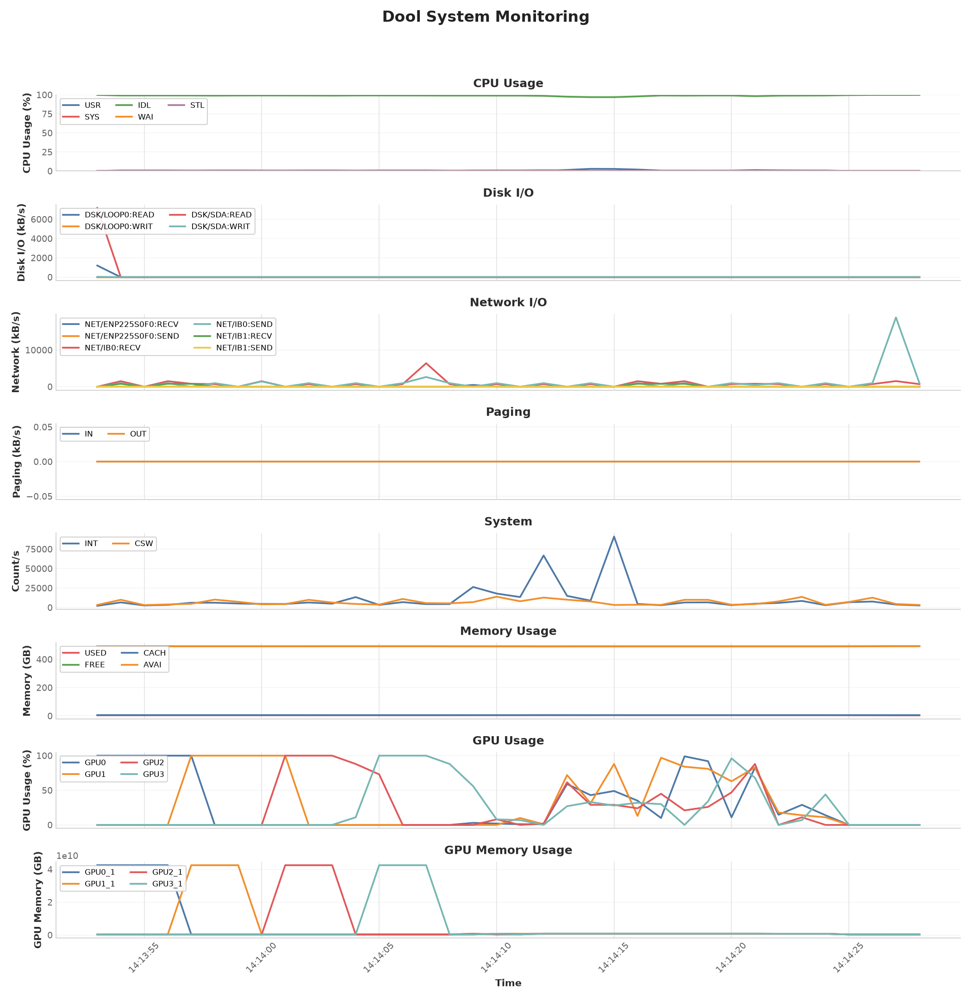
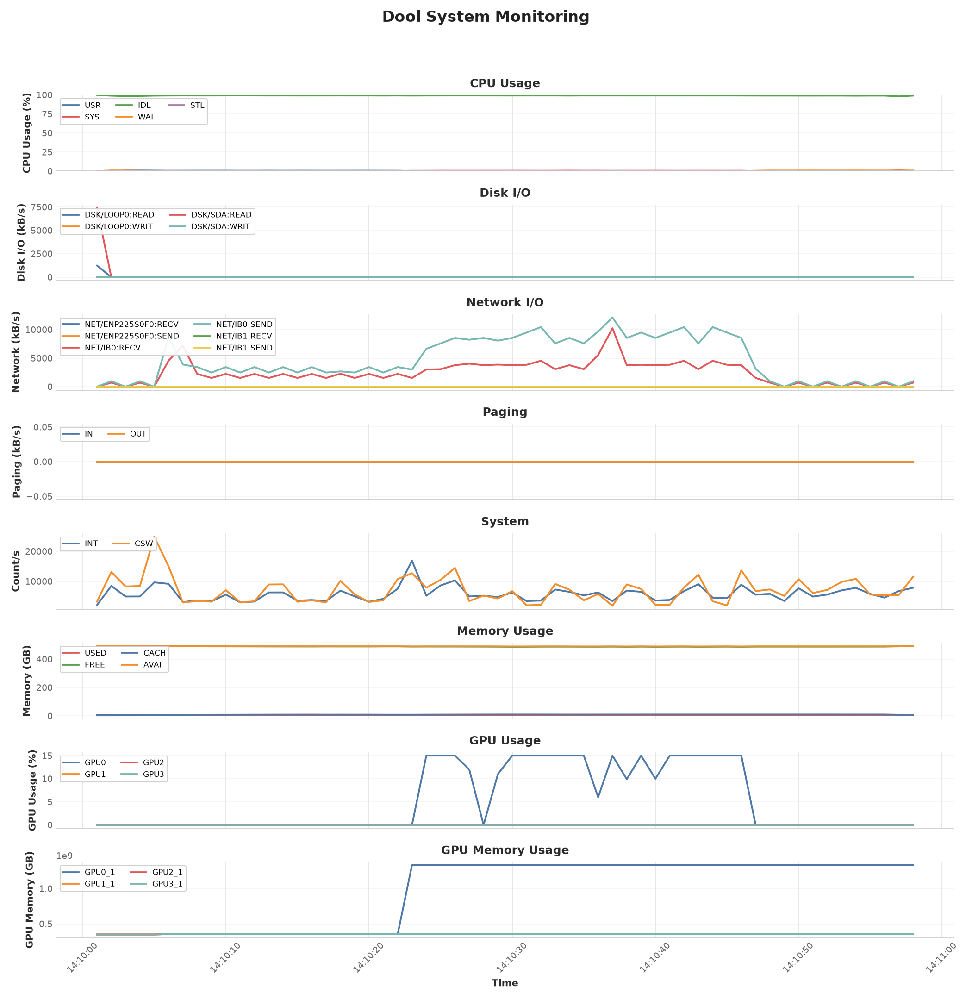

# Dool Monitoring on Slurm HPC (Meluxina)

This repo makes it possible to use [dool](https://github.com/scottchiefbaker/dool) in order to track the system resource usage on a compute node, then plot the results.
We also include here the possibility to monitor GPU activity (NVIDIA cards).

Everything is packaged into an [Apptainer](https://apptainer.org/) image, so it runs the same way on any machine with no per-user Python setup.

GPU access is a **run-time** concern only: `pynvml` picks up `libnvidia-ml.so` from the host driver via `apptainer exec --nv`, so the image builds even on a machine without a GPU.

In the following, we explain how to build the `dool` apptainer image that we can then use to perform the monitoring.
We then give a couple of examples that have been run on the Meluxina supercomputer.

## Step 1: Build the apptainer image

On any host with Apptainer (no registry account and no image push required):

```bash
apptainer build dool.sif dool-monitoring.def
```

The recipe ([dool-monitoring.def](dool-monitoring.def)) bootstraps from the public `python:3.11-slim`
base and runs [setup_dool_and_venv.sh](setup_dool_and_venv.sh) used to set up `dool` by hand:
it installs `dool`, the NVIDIA GPU plugins from [dool_plugins/](dool_plugins/) and the plotting
dependencies (`matplotlib`, `pandas`, `nvidia-ml-py`).

## Step2: Record metrics

First, ensure the apptainer image `dool.sif` you just built is on the host where you want to monitor activity

### On a node with one or multiple NVIDIA gpus

On a GPU node, grant GPU access with `--nv` and record the metrics you want:

```bash
apptainer exec --nv dool.sif \
    dool -tTcdngym 1 --nvidia-gpu --nvidia-gpu-mem --full --output=metrics.csv
```

You can run it in the background while your workload runs (see the examples), then stop it:

```bash
apptainer exec --nv dool.sif dool -tTcdngym 1 --nvidia-gpu --nvidia-gpu-mem --full --output=metrics.csv &
# ... run your workload ...
# stop the recording once you are done
```

### On a node without an NVIDIA gpu

On a machine without an NVIDIA GPU (or if you omit `--nv`), drop the `--nvidia-gpu*` flags and `dool`
records its CPU / disk / network / paging / system / memory panels instead:

```bash
apptainer exec dool.sif \
    dool -tTcdngym 1 --full --output=metrics.csv
```

## Plot the recorded CSV

The image also ships [run_postprocess.sh](run_postprocess.sh) / [dool_postprocess.py](dool_postprocess.py),
which turn a `dool` CSV into a multi-panel plot:

```bash
apptainer exec -B $DOOL_OUTPUT_DIR "$SIF" bash /opt/dool-monitoring/run_postprocess.sh "$DOOL_OUTPUT_CSV" "$DOOL_OUTPUT_PLOTS"
```

## Examples

We provided a couple of examples ready to be run on the compute node of Meluxina.
The goal is to see how `dool` can be used to monitor the hardware activity of different workloads.

### `nvidia-dcgmi` example

`dcgmi` is the command-line interface (CLI) utility for NVIDIA Data Center GPU Manager (DCGM), a suite of tools designed to manage, monitor, and diagnose NVIDIA datacenter GPUs in cluster environments.  `nvidia-dcgmi` is readily available on Meluxina GPU compute nodes.
It can be used to make a quick check on the performances of a GPU card with:

```bash
sbatch -A <your_project_on_meluxina> example_with_nvidia_dcgmi/run_dool_dgcmi_example.sh
```

This slurm job will run `dcgmi`, monitor the activity of the node in the background and plot the metrics collected at the end.
The result is written to `dooloutput/dool_result_profiling_<JOBID>.png`:

An example of output can be found below



### Lustre-io intensive example

`example_with_lustre_io/lustre_io_workload.py` is an I/O-intensive workload that stresses the Lustre filesystem backing the
compute node while loading data batches onto the GPU.

You can launch it by submitting it to the slurm scheduler using:

```bash
sbatch -A <your_project_on_meluxina> example_with_lustre_io/run_dool_lustre_io_example.sh
```

This Slurm job runs the workload in the foreground and `dool` in the background, then plots the metrics collected at the end. The result is written to `dooloutput/dool_result_profiling_<JOBID>.png`:

It has two phases, both of which hit Lustre: a **dataset-creation** phase that writes 32×128 MB files (`lustre_data/shard_*.bin`), stressing Lustre *writes*, followed by a **batch-loading** phase that reads random files back and copies them onto the GPU, stressing Lustre *reads* and the host → device transfer.

Every phase and step is logged with a wall-clock timestamp (and the used GPU memory in the `[STEP]` lines). Because the timestamps share the same clock as the Slurm log and the `dool` CSV, a spike in the `dsk/...` / `net/...` panel lines up with the `[STEP]` read lines, so the Lustre activity can be correlated with what the workload was doing at that moment.

An example of output can be found below


