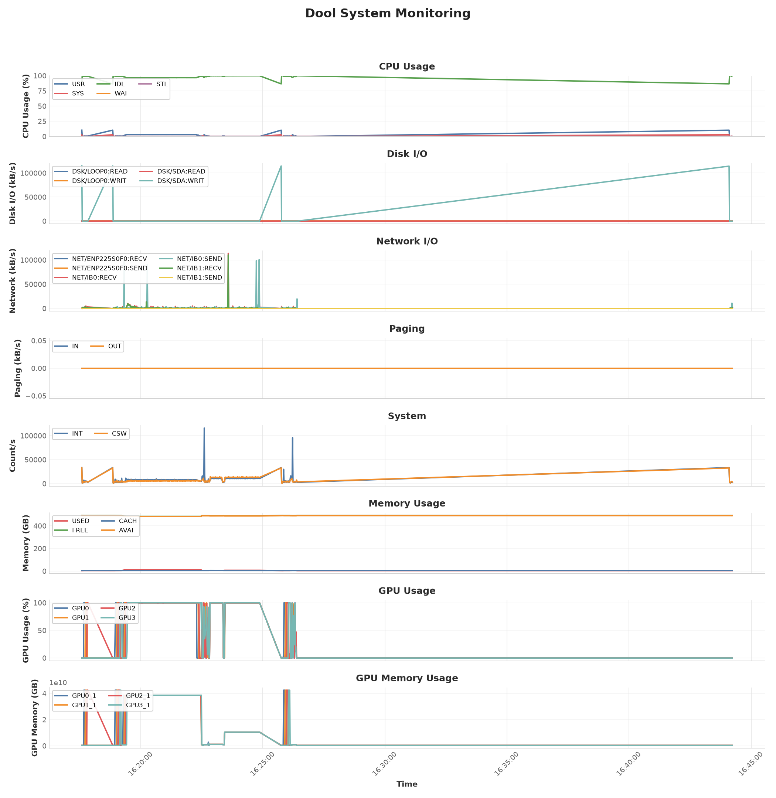
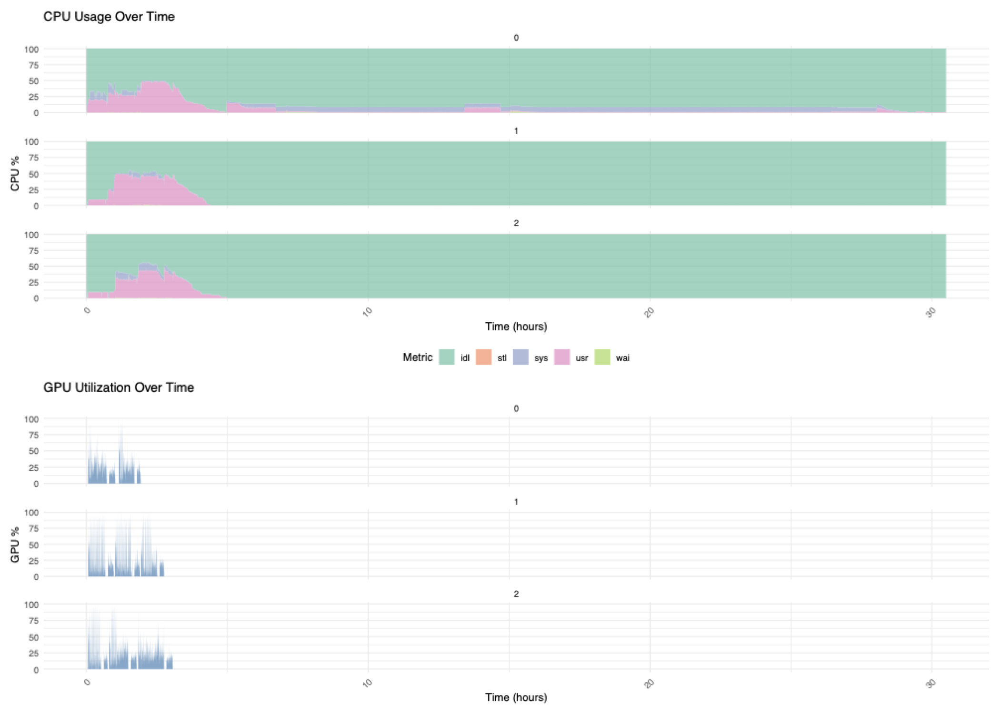

# Dool Monitoring on Slurm HPC (Meluxina)

Track system and **GPU** resource usage during a Slurm job with the [dool](https://github.com/scottchiefbaker/dool) tool, then plot the results.

Although tailored for Meluxina, the scripts work on any Slurm HPC with `dool` and NVIDIA GPU monitoring.

## Setup

```bash
source setup_dool_and_venv.sh
```

This installs [`uv`](https://docs.astral.sh/uv/), creates a `.venv` with `matplotlib`, `pandas` and `pynvml`, clones `dool`, and copies the NVIDIA GPU plugins from `dool_plugins/`.

## Run an example job

```bash
sbatch dcgmi-monitoring/run_dool_dgcmi_example.sh
```

The job records CPU, disk, network, memory, system and NVIDIA GPU (usage + memory) metrics every second into `dooloutput/dool_profiling_<JOBID>.csv`.

## Lustre IO example

```bash
sbatch example_with_lustre_io/run_dool_lustre_io_example.sh
```

This example stresses the Lustre filesystem that backs the working directory. The workload (`example_with_lustre_io/lustre_io_workload.py`) runs in two phases:

1. **Dataset creation** — writes a number of random dataset files to disk (Lustre *writes*).
2. **Batch loading** — repeatedly picks random dataset files, reads them back from Lustre, assembles a batch and copies it onto the GPU (Lustre *reads* + host→device transfer).

Every phase and every step is logged with a wall-clock timestamp (and the GPU memory usage when available), e.g.:

```
2026-10-27T13:35:46 [STEP] 0000/0099 files=[shard_00003.bin,shard_00000.bin] read_mb=512.0 read_s=0.42 gpu_mem_used_gb=2.1 step_s=0.46
```

Because those timestamps use the same clock as the Slurm log and the `dool` CSV recorded in parallel, you can correlate the two: a spike in the `dsk/...` or `net/...` panels lines up with the `[STEP]` read lines. Scale the IO pressure with `--num-files`, `--file-size-mb`, `--num-steps` and `--files-per-step` (see `--help`).

## Plot the results

```bash
./run_postprocess.sh <csv> <output.pdf>   # specific input and output
```

`run_postprocess.sh` wraps `dool_postprocess.py`, which turns a `dool` CSV into a multi-panel plot.

> **Note:** The plots above are just examples of what you can do with the `dool` CSV output — feel free to post-process it with your own tooling. The `dcgmi` example uses the provided `dool_postprocess.py`, while the Sarek example was plotted with the R script in `example_with_sarek/dool-plots/dool-monitoring.R`.

## Example output for the simple `nvidia-dcgmi` test



## Example output for the Sarek workflow (plotting done without `run_postprocess.sh`)



## Files

| Path | What it does |
| ------ | -------------- |
| `setup_dool_and_venv.sh` | Set up `dool`, the venv and the GPU plugins |
| `run_postprocess.sh` | Post-process a `dool` CSV into a plot |
| `dool_postprocess.py` | Plotting script (CPU, disk, network, paging, system, memory, GPU) |
| `dool_plugins/` | `dool` plugins for NVIDIA GPU usage and memory |
| `dcgmi-monitoring/` | Example Slurm job based on `dcgmi` |
| `example_with_lustre_io/` | Example Slurm job that stresses Lustre IO (dataset creation + GPU batch loading) |
| `example_with_sarek/` | Example Slurm job based on Sarek |
